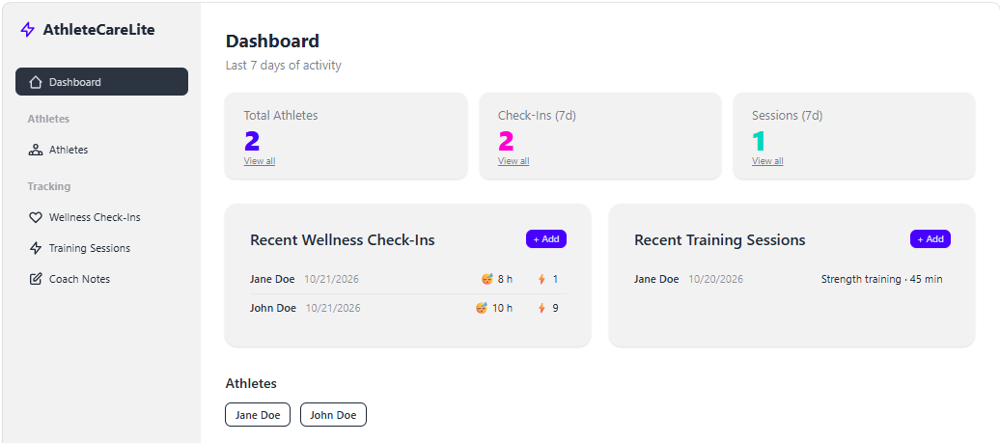

# AthleteCareLite

AthleteCareLite is a lightweight athlete tracking and performance monitoring application built with ASP.NET Core and Razor Components. It helps coaches and staff manage athlete records, wellness check-ins, training sessions, and coaching notes from a single dashboard-driven interface.

## Dashboard



## Overview

AthleteCareLite is designed for sports programs that need a simple, centralized view of athlete activity and readiness. The application focuses on four core workflows:

- Athlete management and profile tracking
- Wellness check-ins for recovery and readiness monitoring
- Training session tracking by activity, duration, and notes
- Coach notes for performance feedback and communication

## Features

- Dashboard summary with key metrics for recent activity
- Athlete directory with profile details and school/sport information
- Wellness tracking for sleep, soreness, mood, and readiness scores
- Training session logging by date, activity, and duration
- Coaching notes attached to athlete records
- Data persistence through EF Core and SQL Server

## Tech Stack

- ASP.NET Core 9
- Razor Components / Blazor Server
- Entity Framework Core 9
- SQL Server / LocalDB
- .NET 9 SDK

## Architecture

The solution follows a simple layered structure to keep the domain model separated from persistence and UI concerns:

- `AthleteCareLite.Core` — domain models and repository interfaces
- `AthleteCareLite.Infrastructure` — EF Core DbContext and repository implementations
- `AthleteCareLite.Web` — Blazor web application and dashboard UI

## Project Structure

```text
AthleteCareLite/
├── AthleteCareLite.Core/
│   ├── Models/
│   └── Interfaces/
├── AthleteCareLite.Infrastructure/
│   ├── Repositories/
│   ├── AppDbContext.cs
│   └── Migrations/
├── AthleteCareLite.Web/
│   ├── Components/
│   ├── Program.cs
│   └── appsettings.json
├── docs/
│   └── screenshots/
├── README.md
├── AthleteCareLite.slnx
├── LICENSE
└── .gitignore
```

## Getting Started

1. Ensure the .NET 9 SDK is installed.
2. Restore dependencies:

```bash
dotnet restore
```

3. Build the solution:

```bash
dotnet build
```

4. Run the web application:

```bash
dotnet run --project AthleteCareLite.Web
```

5. Open the application in your browser and navigate to the dashboard.

## Notes

The app is configured to use a SQL Server connection string named `DefaultConnection` in the web project configuration. In local development, this commonly targets LocalDB or a local SQL Server instance.
